# 🛡️ NovaSRE — Autonomous Site Reliability Engineering Platform (ADK 2.0, A2A & Argolis WAF Edition)


Welcome to **NovaSRE**, an enterprise-grade autonomous Site Reliability Engineering (SRE) and self-healing infrastructure platform built on **Google Cloud Vertex AI Reasoning Engines (ADK 2.0)**, **Agent-to-Agent (A2A) Protocols**, **A2UI v0.8 HITL Cards**, **Model Armor**, and universal **OneMCP APIs**.

NovaSRE operates across a hardened **Hub-and-Spoke multi-project architecture** in **`europe-west1`** within the `jpaquay.altostrat.com` Argolis organization:
- **Spoke / Runtime Host Project (`antigravity-web-hub-argolis`, `723040006558`)**: Hosts the 4 Vertex AI Reasoning Engines (`rca-telemetry-expert`, `remediation-executor`, `outage-simulator`, `incident-report-writer`), the `online-boutique` GKE Autopilot cluster, Direct IAP-protected Cloud Run services, and the `gs://antigravity-web-hub-argolis-telemetry` & `gs://antigravity-web-hub-argolis-sre-playbooks` buckets.
- **Central Logging & Audit Hub (`argodev-prod-audit-logs-0` / `cs-audit`, `618001173803`)**: Aggregates cross-project GKE, Cloud Run, Reasoning Engine, and Privileged Access Manager (PAM) logs via Cloud Logging sinks (`sre-gke-pam-telemetry-sink`) and hosts the `sre_releases` BigQuery dataset (`recent_releases` and `incident_postmortems` with `PHYSICAL` storage billing in `europe-west1`).

> 📖 **Architecture & Operator Documentation**:
> - [**WAF ADR & Master Implementation Plan**](docs/WAF_ADR_AND_IMPLEMENTATION_PLAN.md)
> - [**Argolis 11-Scenario SRE Operator Runbook**](docs/ARGOLIS_SRE_PLAYBOOKS_RUNBOOK.md)
> - [**WAF 5-Pillar Architecture Blueprint**](docs/WAF_ARCHITECTURE_BLUEPRINT.md)
> - [**Platform Architecture & Workflow Deep-Dive**](docs/architecture.md)
> - [**Gemini Enterprise Agent Registration Guide**](register_agent.md)

---

## 🏗️ 1. Platform Architecture & Hub-and-Spoke Workflow

The NovaSRE ecosystem consists of 4 specialized Vertex AI Reasoning Engine agents isolated by **4 dedicated least-privilege Service Accounts**, protected by **Model Armor** inline screening, registered with **Gemini Enterprise** and the **`aibru26` SRE Sentinel / Copilot** as operator front doors, and backed by **35 modular skills**:

```mermaid
graph TD
    subgraph FrontDoors ["Operator Front Doors (europe-west1)"]
        GE["Gemini Enterprise Console<br/>Natural-Language Chat, Routing<br/>& A2UI v0.8 HITL Approval"]
        COPILOT["aibru26 SRE Sentinel & Copilot<br/>12-Agent A2A Arena Integration"]
    end

    subgraph RuntimeHost ["Spoke Runtime Host: antigravity-web-hub-argolis (723040006558 / europe-west1)"]
        MA["Model Armor Inline Screening<br/>Prompt Injection & SDP Guard"]
        InvAgent["Investigator Agent<br/><b>rca-telemetry-expert</b><br/>SA: sre-investigator-sa (Read-Only)"]
        RemAgent["Remediation Worker<br/><b>remediation-executor</b><br/>SA: sre-remediator-sa (A2A + PAM JIT)"]
        DocAgent["Documentation Compiler<br/><b>incident-report-writer</b><br/>SA: sre-reporter-sa (Async Writer)"]
        SimAgent["Chaos Engine<br/><b>outage-simulator</b><br/>SA: sre-simulator-sa (11 Simulations)"]
        GKE["GKE Autopilot: online-boutique<br/>europe-west1 (12 Microservices)"]
        GCS["GCS Buckets<br/>gs://antigravity-web-hub-argolis-telemetry<br/>& gs://antigravity-web-hub-argolis-sre-playbooks"]
    end

    subgraph SkillEcosystem ["Modular Skill Ecosystem (35 Skills)"]
        DiagSkills["Layer 1: Diagnostics & Triage<br/>10 Specialist Skills"]
        PlaybookSkills["Layer 2: Recovery Playbooks<br/>11 SRE Remediation Playbooks"]
        SimSkills["Layer 3: Chaos Simulations<br/>11 Outage Injection Playbooks"]
        ReportSkills["Layer 4: Incident Reporting<br/>3 Post-Mortem Skills"]
    end

    subgraph OneMCPGateway ["Universal OneMCP Gateway (Dual-Project Aware)"]
        LOG_MCP["Logging OneMCP<br/>logging.googleapis.com"]
        MON_MCP["Monitoring OneMCP<br/>monitoring.googleapis.com"]
        TRACE_MCP["Trace OneMCP<br/>cloudtrace.googleapis.com"]
        ERR_MCP["Error Reporting OneMCP<br/>clouderrorreporting.googleapis.com"]
        GKE_MCP["GKE OneMCP<br/>container.googleapis.com"]
        COMPUTE_MCP["Compute & VPC OneMCP<br/>compute.googleapis.com"]
        BQ_MCP["BigQuery OneMCP<br/>bigquery.googleapis.com"]
        GCS_MCP["GCS OneMCP<br/>storage.googleapis.com"]
    end

    subgraph AuditHub ["Central Logging & Audit Hub: argodev-prod-audit-logs-0 (618001173803 / cs-audit)"]
        BQ_REL["BigQuery: sre_releases.recent_releases<br/>PHYSICAL Billing + Clustered"]
        BQ_INC["BigQuery: sre_releases.incident_postmortems<br/>MTTD/MTTR + PAM Grant Audit"]
        BQ_AUDIT["BigQuery: audit_export & agent_analytics<br/>Cross-Org Audit Logs & OTel Spans"]
    end

    GE <-->|"1. Trigger Alert / HITL Approval"| MA
    COPILOT <-->|"A2A / REST"| MA
    MA <--> InvAgent
    GE -->|"2. Trigger Chaos Scenario"| SimAgent

    InvAgent -->|"A2A + [PAM_JUSTIFICATION]"| RemAgent
    InvAgent -.->|"Async Zero-Call Post-Mortem"| DocAgent

    InvAgent --- DiagSkills
    InvAgent --- PlaybookSkills
    SimAgent --- SimSkills
    DocAgent --- ReportSkills

    InvAgent --> LOG_MCP
    InvAgent --> MON_MCP
    InvAgent --> TRACE_MCP
    InvAgent --> ERR_MCP
    InvAgent --> GKE_MCP
    InvAgent --> COMPUTE_MCP
    InvAgent --> BQ_MCP
    InvAgent --> GCS_MCP

    RemAgent --> GKE_MCP
    RemAgent --> COMPUTE_MCP
    SimAgent --> GKE_MCP
    DocAgent --> GCS_MCP
    DocAgent --> BQ_MCP

    GKE_MCP --> GKE
    COMPUTE_MCP --> GKE
    BQ_MCP --> BQ_REL
    BQ_MCP --> BQ_INC
    LOG_MCP --> BQ_AUDIT
    GCS_MCP --> GCS
```



### Core Agents & Dedicated Service Accounts (`antigravity-web-hub-argolis`)

1. **`rca-telemetry-expert` (The Diagnostician & Unified Investigator)**:
   * **Dedicated Identity**: `sre-investigator-sa@antigravity-web-hub-argolis.iam.gserviceaccount.com` (**Strictly Read-Only** on `antigravity-web-hub-argolis` + cross-project `logging.viewer`, `bigquery.dataViewer`, and `bigquery.jobUser` on `argodev-prod-audit-logs-0`).
   * **Model Routing**: Uses `gemini-2.5-flash` (`GEMINI_MODEL`) for fast baseline triage with automatic `global` $\leftrightarrow$ `europe-west1` failover, and `gemini-3.1-pro-preview` (`GEMINI_PRO_MODEL`) for Tier 3 zero-day escalation.
   * **Function**: Screens prompts with **Model Armor** (`screen_prompt_with_model_armor`), performs dual-project triage across `antigravity-web-hub-argolis` and `argodev-prod-audit-logs-0` (`cs-audit`), loads the `investigation-entrypoint` and specialist diagnostic skills, correlates with `argodev-prod-audit-logs-0.sre_releases.recent_releases`, and delegates remediation to `remediation-executor` via A2A.

2. **`remediation-executor` (The Secure Healing Worker)**:
   * **Dedicated Identity**: `sre-remediator-sa@antigravity-web-hub-argolis.iam.gserviceaccount.com` (**Mutating Worker**: `container.developer`, `compute.networkAdmin`, plus `eligibleUser` on the `gke-editor` **Privileged Access Manager (PAM)** entitlement).
   * **Function**: Receives structured healing commands over A2A, verifies PAM JIT elevation and `[PAM_JUSTIFICATION]:` audit trails for Tier 2 HITL actions, executes declarative OneMCP API operations, and returns verified recovery timestamps.

3. **`incident-report-writer` (The Documentation Compiler & Post-Mortem Expert)**:
   * **Dedicated Identity**: `sre-reporter-sa@antigravity-web-hub-argolis.iam.gserviceaccount.com` (`storage.objectAdmin` on `gs://antigravity-web-hub-argolis-telemetry`, plus cross-project `roles/bigquery.dataEditor` and `roles/bigquery.jobUser` on `argodev-prod-audit-logs-0:sre_releases`).
   * **Function**: Compiles publication-ready GitHub Flavored Markdown post-mortems asynchronously using pre-extracted log timestamps (zero extra telemetry calls), archives reports to `gs://antigravity-web-hub-argolis-telemetry/reports/post_mortem_<id>.md`, and inserts structured MTTD/MTTR rows into `argodev-prod-audit-logs-0.sre_releases.incident_postmortems`.

4. **`outage-simulator` (The Chaos Engineering Agent)**:
   * **Dedicated Identity**: `sre-simulator-sa@antigravity-web-hub-argolis.iam.gserviceaccount.com` (`container.developer` on target cluster).
   * **Function**: Dynamically loads all **11 simulation playbooks** from `app/skills/simulations/` to inject controlled failure modes across GKE `online-boutique` and the Argolis fleet.

---

## 🌟 2. Comprehensive 11-Scenario Chaos & Self-Healing Matrix (8 GKE + 3 Argolis Fleet)

NovaSRE provides **11 fully orchestrated scenarios** spanning Kubernetes workloads, container rollouts, database availability, traffic routing, DNS resolution, Cloud NAT, Direct Cloud Run IAP, Vertex AI quota/model failover, and Shared VPC / Log Router sinks:

| # | Scenario / Simulation Skill | Target Resource (`europe-west1`) | Simulated Outage Action (`outage-simulator`) | SRE Recovery Playbook (`app/skills/playbooks/`) | Governance Tier & Execution Policy |
| :- | :--- | :--- | :--- | :--- | :--- |
| **1** | `gke-scale-outage` | `frontend` (`online-boutique`) | Scales active replicas to **`0`** (`replicas: 0`) causing HTTP 503 errors across the store. | **Playbook 1 (`gke-scale-recovery`)**: Scale `frontend` back to `1` active replica. | **Tier 1 (Auto-Recovery)**<br>Pre-approved fast-path. Auto-healed via A2A. |
| **2** | `gke-bad-rollout` | `cartservice` (`online-boutique`) | Deploys invalid container revision (`cartservice:broken-v2`) causing pod `CrashLoopBackOff`. | **Playbook 2 (`gke-crashloop-rollback`)**: Correlates `argodev-prod-audit-logs-0.sre_releases.recent_releases` and reverts to `v1.0.4`. | **Tier 1 (Auto-Rollback)**<br>Causal deployment correlation fast-path. Auto-reverted via A2A. |
| **3** | `gke-pod-crash` | `redis-cart` (`online-boutique`) | Terminates active pods and simulates connection pool memory locks. | **Playbook 3 (`gke-pod-restart`)**: Execute clean rolling restart (`rollout restart deployment/redis-cart`). | **Tier 2 (HITL + PAM JIT)**<br>Requires operator approval before database disruption. |
| **4** | `gke-payment-latency` | `paymentservice` (`online-boutique`) | Throttles capacity to `1 replica` under peak synthetic checkout surges, causing p99 latency `>2000ms`. | **Playbook 4 (`gke-horizontal-upsize`)**: Scale deployment up to **`3 replicas`** to absorb load. | **Tier 2 (HITL + PAM JIT)**<br>Requires operator approval for capacity/cost scaling. |
| **5** | `gke-network-firewall-block` | `checkoutservice` (`online-boutique`) | Injects restrictive `NetworkPolicy` dropping all ingress and egress packets. | **Playbook 5 (`gke-network-firewall-recovery`)**: Delete blocking NetworkPolicy to restore pod networking. | **Tier 2 (HITL + PAM JIT)**<br>Requires operator confirmation to modify network policies. |
| **6** | `gke-dns-outage` | `coredns` (`kube-system`) | Scales CoreDNS to **`0`** replicas, inducing cluster-wide `.svc.cluster.local` resolution timeouts. | **Playbook 6 (`gke-dns-recovery`)**: Scale CoreDNS deployment back to `2` healthy replicas. | **Tier 1 / Tier 2 Recovery**<br>Restores cluster DNS capacity via A2A. |
| **7** | `gcp-nat-port-drop` | `sre-agent-nat` (`europe-west1`) | Simulates Cloud NAT SNAT port exhaustion and outbound packet drop. | **Playbook 7 (`gcp-nat-port-recovery`)**: Increase `minPortsPerVm` from 64 to 256 on Cloud NAT gateway. | **Tier 2 (HITL + PAM JIT)**<br>Requires operator confirmation for VPC gateway reconfiguration. |
| **8** | `gke-service-routing-break` | `checkoutservice` (K8s Service) | Patches K8s Service selector to invalid `app=broken-selector`, disconnecting endpoints. | **Playbook 8 (`gke-service-routing-recovery`)**: Restore Service selector to target `app=checkoutservice`. | **Tier 2 (HITL + PAM JIT)**<br>Requires operator confirmation to patch Service definitions. |
| **9** | `argolis-cloudrun-iap-drift` | `antigravity-web-hub` (Cloud Run IAP) | Simulates Direct Cloud Run IAP `403 Forbidden` (missing `service-723040006558@gcp-sa-iap.iam.gserviceaccount.com` `roles/run.invoker`), `403 org_internal` OAuth mismatch, or `302 empty token`. | **Playbook 9 (`argolis-cloudrun-iap-recovery`)**: Restore IAP SA `roles/run.invoker` & custom OAuth client (`go/argolis-iam-rules`: zero `allUsers`/`@google.com`). | **Tier 2 (HITL + PAM JIT)**<br>Requires operator approval to modify Cloud Run IAM / IAP settings. |
| **10** | `argolis-vertex-quota-spike` | Vertex AI Reasoning Engines (`europe-west1`) | Simulates Vertex AI `HTTP 429 RESOURCE_EXHAUSTED`, unprovisioned `404` (`gemini-3.7-flash`), or Gemini 3.x `400` missing `thoughtSignature`. | **Playbook 10 (`argolis-vertex-quota-failover`)**: Auto-failover to `gemini-2.5-flash` (`global` $\leftrightarrow$ `europe-west1`) & verify Model Armor `INSPECT_AND_BLOCK`. | **Tier 1 (Auto-Recovery)**<br>Pre-approved model/endpoint failover via A2A. |
| **11** | `argolis-sharedvpc-logsink-lag` | Shared VPC `sb-prod-ew1-shared` & Sink `sre-gke-pam-telemetry-sink` | Simulates Shared VPC `roles/compute.networkUser` drift on `cs-host-78e19ed8055b4c6980cce9` and central log sink lag to `argodev-prod-audit-logs-0`. | **Playbook 11 (`argolis-sharedvpc-logsink-recovery`)**: Restore subnet `networkUser` bindings & grant sink `writerIdentity` `roles/bigquery.dataEditor` on `sre_releases`. | **Tier 2 (HITL + PAM JIT)**<br>Requires operator approval for cross-project IAM & sink reconciliation. |

---

## 🛡️ 3. The 3-Tier Operational Resolution Hierarchy

NovaSRE balances execution speed with production safety through a strict 3-tier resolution hierarchy:

1. **Tier 1: Autonomous Auto-Remediation (High Confidence / Low Risk — Playbooks 1, 2, 6, 10)**  
   * **Trigger**: Root cause analysis precisely correlates with an established auto-recovery playbook (`gke-scale-recovery`, `gke-crashloop-rollback`, `gke-dns-recovery`, `argolis-vertex-quota-failover`).
   * **Execution Flow**: `rca-telemetry-expert` loads the playbook and delegates directly to `remediation-executor` via A2A. Health is restored in seconds with zero operator intervention.

2. **Tier 2: Gated Human-in-the-Loop + PAM JIT Remediation (High Impact — Playbooks 3, 4, 5, 7, 8, 9, 11)**  
   * **Trigger**: Root cause matches a playbook involving stateful disruption, database connection restarts, network policy deletion, capacity/cost scaling, Direct Cloud Run IAP IAM changes, or Shared VPC / Log Router sink bindings.
   * **Execution Flow**: The agent prepares an **Executive Resolution Brief** and renders an **A2UI v0.8 approval widget** in Gemini Enterprise. Execution is held until an SRE reviews the evidence and clicks **`[ ✅ Approve & Execute ]`**, triggering PAM JIT elevation (`gke-editor`) with an immutable `[PAM_JUSTIFICATION]:` audit trail in `argodev-prod-audit-logs-0`.

3. **Tier 3: Autonomous Zero-Shot LLM Fallback (`gemini-3.1-pro-preview`)**  
   * **Trigger**: The anomaly does not match any pre-configured playbook or release ledger record.
   * **Execution Flow**: `rca-telemetry-expert` escalates to `gemini-3.1-pro-preview` (`GEMINI_PRO_MODEL`) to synthesize a custom recovery plan from raw telemetry and presents it for Tier 2 HITL review.

---

## 📚 4. Modular 4-Layer Skill Architecture (35 Skills)

NovaSRE is powered by **35 modular skills** organized into 4 functional layers and synced to `gs://antigravity-web-hub-argolis-sre-playbooks/playbooks/`:

```text
app/skills/
├── diagnostics/                                # Layer 1: Specialist Triage & Signal Skills (10 skills)
│   ├── investigation-entrypoint/SKILL.md       # Generic incident orchestrator & 11-scenario router
│   ├── sre-correlation/SKILL.md                # Cross-signal & argodev-prod-audit-logs-0 BQ pivot
│   ├── gke-workloads/SKILL.md                  # Pod lifecycle, CrashLoopBackOff, resource limits
│   ├── gke-networking/SKILL.md                 # Dataplane V2, CoreDNS, ClusterIP service routing
│   ├── gcp-logging/SKILL.md                    # Dual-project Cloud Logging queries & timestamp extraction
│   ├── gcp-monitoring/SKILL.md                 # PromQL, timeseries alignment, alert inspection
│   ├── gcp-trace/SKILL.md                      # Distributed trace breakdown & latency waterfall
│   ├── gcp-error-reporting/SKILL.md            # Exception group stats & deduplicated stack traces
│   ├── google-cloud-networking-observability/  # VPC flow logs, firewall rules, Cloud NAT SNAT
│   └── google-cloud-global-frontend-config/    # Cloud Armor WAF, Direct Cloud Run IAP, External ALBs
│
├── playbooks/                                  # Layer 2: Targeted SRE Recovery Playbooks (11 playbooks)
│   ├── gke-scale-recovery/SKILL.md             # Playbook 1: Deployment scale recovery (Tier 1)
│   ├── gke-crashloop-rollback/SKILL.md         # Playbook 2: Bad rollout rollback via BQ (Tier 1)
│   ├── gke-pod-restart/SKILL.md                # Playbook 3: Redis pod rolling restart (Tier 2)
│   ├── gke-horizontal-upsize/SKILL.md          # Playbook 4: Payment horizontal scaling (Tier 2)
│   ├── gke-network-firewall-recovery/SKILL.md  # Playbook 5: NetworkPolicy unblock (Tier 2)
│   ├── gke-dns-recovery/SKILL.md               # Playbook 6: CoreDNS capacity recovery (Tier 1)
│   ├── gcp-nat-port-recovery/SKILL.md          # Playbook 7: Cloud NAT min-ports increase (Tier 2)
│   ├── gke-service-routing-recovery/SKILL.md   # Playbook 8: K8s Service selector restore (Tier 2)
│   ├── argolis-cloudrun-iap-recovery/SKILL.md  # Playbook 9: Direct Cloud Run IAP & OAuth recovery (Tier 2)
│   ├── argolis-vertex-quota-failover/SKILL.md  # Playbook 10: Vertex AI 429/404 failover & Model Armor (Tier 1)
│   └── argolis-sharedvpc-logsink-recovery/     # Playbook 11: Shared VPC networkUser & Log Sink recovery (Tier 2)
│
├── simulations/                                # Layer 3: Chaos Engineering Playbooks (11 simulations)
│   ├── gke-scale-outage/SKILL.md               # Sim 1: Scale frontend deployment to 0
│   ├── gke-bad-rollout/SKILL.md                # Sim 2: Invalidate cartservice image to broken-v2
│   ├── gke-pod-crash/SKILL.md                  # Sim 3: Terminate redis-cart pods & lock memory
│   ├── gke-payment-latency/SKILL.md            # Sim 4: Downscale paymentservice under surge load
│   ├── gke-network-firewall-block/SKILL.md     # Sim 5: Restrictive NetworkPolicy on checkout
│   ├── gke-dns-outage/SKILL.md                 # Sim 6: Scale CoreDNS to 0 replicas
│   ├── gcp-nat-port-drop/SKILL.md              # Sim 7: Cloud NAT SNAT port exhaustion
│   ├── gke-service-routing-break/SKILL.md      # Sim 8: Inject broken selector on checkout Service
│   ├── argolis-cloudrun-iap-drift/SKILL.md     # Sim 9: Inject Direct Cloud Run IAP 403 drift
│   ├── argolis-vertex-quota-spike/SKILL.md     # Sim 10: Trigger Vertex AI 429 & model routing alert
│   └── argolis-sharedvpc-logsink-lag/SKILL.md  # Sim 11: Inject Shared VPC & central log sink lag alert
│
└── reporting/                                  # Layer 4: Post-Mortem & Incident Reporting (3 skills)
    ├── postmortem-generator/SKILL.md           # Log-derived timeline builder + GCS & BQ archival
    ├── postmortem-documentation/SKILL.md       # Premium Markdown styling & executive structure
    └── postmortem-aggregator/SKILL.md          # Multi-source diagnostic & MTTD/MTTR synthesis
```

---

## ⏱️ 5. Zero-Call Telemetry Timeline & Dual GCS + BigQuery Post-Mortems

To eliminate redundant API calls and prevent token bloat during post-incident documentation:

1. **Structured SRE Fact Extraction**: During baseline triage, `rca-telemetry-expert` extracts `incident_start_time` (first log error / metric anomaly) and `detection_time`.
2. **Verified Execution Timestamps**: When `remediation-executor` runs a fix, it records `mitigation_executed_time`, `recovery_verified_time`, and `pam_grant_name`.
3. **Dual Archival (`archive_postmortem_report`)**: `incident-report-writer` compiles the Markdown report from session context—**making zero additional OneMCP telemetry calls**—and:
   - Archives the report to **`gs://antigravity-web-hub-argolis-telemetry/reports/post_mortem_<id>.md`**.
   - Inserts a structured MTTD/MTTR row into **`argodev-prod-audit-logs-0.sre_releases.incident_postmortems`** (`europe-west1`).

---

## 📦 6. Central BigQuery Deployment & Post-Mortem Ledger (`argodev-prod-audit-logs-0`)

All release correlation and post-mortem analytics are stored in the Central Audit & Logging Hub **`argodev-prod-audit-logs-0`** (`cs-audit`, `europe-west1`, `PHYSICAL` storage billing):

```sql
-- 1. Causal Deployment Correlation (Clustered by service_name, namespace)
SELECT release_id, service_name, namespace, revision, commit_sha, author_email, timestamp_utc, status
FROM `argodev-prod-audit-logs-0.sre_releases.recent_releases`
WHERE service_name = 'cartservice'
ORDER BY timestamp_utc DESC
LIMIT 1;

-- 2. Historical Incident & MTTD/MTTR Analytics (Partitioned by DATE(incident_start_time))
SELECT incident_id, severity, target_resource, mttd_seconds, mttr_seconds, pam_grant_name, report_gcs_uri
FROM `argodev-prod-audit-logs-0.sre_releases.incident_postmortems`
ORDER BY incident_start_time DESC
LIMIT 10;
```

---

## 🚀 7. Comprehensive Deployment Guide (`europe-west1`)

### Configure Environment & Deploy to `antigravity-web-hub-argolis` (`europe-west1`)

```bash
export GCP_PROJECT_ID="antigravity-web-hub-argolis"
export LOGGING_PROJECT_ID="argodev-prod-audit-logs-0"
export GCP_REGION="europe-west1"

# 1. Configure local .env
cat <<EOF > .env
GCP_PROJECT_ID="antigravity-web-hub-argolis"
LOGGING_PROJECT_ID="argodev-prod-audit-logs-0"
GOOGLE_CLOUD_LOCATION="europe-west1"
GKE_CLUSTER_NAME="online-boutique"
GKE_CLUSTER_REGION="europe-west1"
GEMINI_MODEL="gemini-2.5-flash"
GEMINI_PRO_MODEL="gemini-3.1-pro-preview"
EOF

# 2. Initialize and apply Terraform (provisions 4 SAs, PAM entitlement, BQ in argodev-prod-audit-logs-0, GCS, and GKE)
cd terraform
terraform init
terraform apply \
  -var="gcp_project_id=$GCP_PROJECT_ID" \
  -var="logging_project_id=$LOGGING_PROJECT_ID" \
  -var="gcp_region=$GCP_REGION" \
  -auto-approve

# 3. Deploy the 4 Vertex AI Reasoning Engines in europe-west1
cd ..
python3 deploy_a2a.py
```

### Retrieve Deployed Reasoning Engine URNs

After `deploy_a2a.py` completes, live URNs are saved to `deployed_urns.json` and can also be queried directly:

```bash
export GCP_PROJECT_ID="antigravity-web-hub-argolis"
export GCP_REGION="europe-west1"
export GCP_PROJECT_NUM="723040006558"

cat deployed_urns.json
```

See [**`register_agent.md`**](register_agent.md) for complete Gemini Enterprise registration steps and [**`docs/ARGOLIS_SRE_PLAYBOOKS_RUNBOOK.md`**](docs/ARGOLIS_SRE_PLAYBOOKS_RUNBOOK.md) for all 11 scenario test commands.

---

## 📄 License
Copyright (c) 2026 siri2421 & Google Cloud GTM Engineering. All rights reserved.
Licensed under the Apache-2.0 License.
