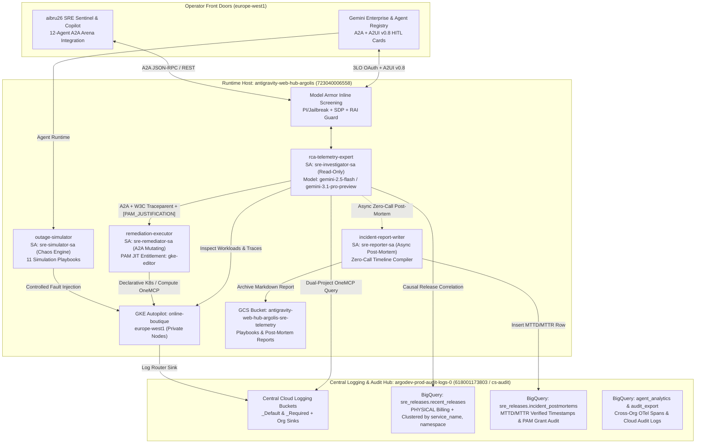

# 🛡️ NovaSRE Next-Gen Argolis Platform — WAF Architecture Decision Record (ADR) & Master Implementation Plan

**Document Version:** 2.0 (Argolis Enterprise Hardened Edition)  
**Date Generated:** 2026-10-05  
**Status:** 🟢 APPROVED BY PRINCIPAL SECURITY & WAF ARCHITECT (`/grill-me` Verified)  
**Source Repository:** `https://github.com/siri2421/sre-agent` $\rightarrow$ [sre-agent](file:///usr/local/google/home/jpaquay/dev/cloud-gtm/sre-agent)  
**Cross-Integration Target:** [aibru26](file:///usr/local/google/home/jpaquay/dev/cloud-gtm/aibru26) (`aicafe-bru26` / `antigravity-web-hub-argolis`)

---

## 🏢 1. Organization Profile & WAF Scoping

| Field | Value |
| :--- | :--- |
| **Organization** | `jpaquay.altostrat.com` (`organizations/916967640475`) |
| **Runtime Host Project** | `antigravity-web-hub-argolis` (Project Number: `723040006558`, Region: `europe-west1`) |
| **Central Logging & Audit Hub (`cs-audit`)** | `argodev-prod-audit-logs-0` (Project Number: `618001173803`, Folder: `Security` `470770306752`) |
| **Core IaC & FinOps Hub** | `argodev-prod-iac-core-0` (Project Number: `668133814987`) |
| **Area of Technology** | `GKE_AUTOPILOT + VERTEX_AI_AGENT_ENGINE + A2A_A2UI + ONEMCP + BIGQUERY_OBSERVABILITY` |
| **Deployment Scale** | `ENTERPRISE_SCALE` (Multi-Project Hub-and-Spoke across Argolis Fleet) |
| **Primary WAF Priorities** | **Security, Operational Excellence, Reliability, Performance & FinOps** |
| **Governing Standards** | Google Cloud WAF 5 Pillars, Elevate 5-Layer Enterprise Agent Governance, `go/argolis-iam-rules` |

---

## 🎯 2. Executive Summary & Architectural Vision

This implementation plan upgrades [`siri2421/sre-agent`](https://github.com/siri2421/sre-agent) (**NovaSRE**) from a single-project `us-central1` prototype into an enterprise-hardened, multi-project autonomous SRE platform running natively in `europe-west1` across the `jpaquay.altostrat.com` Argolis organization.

---

## 🔧 3. WAF 5-Pillar Gap Analysis & Architectural Decisions (`/grill-me` Outcomes)

### Decision 1: Hub-and-Spoke Multi-Project Topology (`Operational Excellence`)
- **Baseline Gap in `siri2421/sre-agent`**: Hardcoded to a single project in `us-central1` where logs, BigQuery, GKE, and Reasoning Engines are co-located.
- **Selected WAF Architecture**:
  - **Spoke / Runtime Project**: `antigravity-web-hub-argolis` (`723040006558`, `europe-west1`) hosts the 4 Vertex AI Reasoning Engines (`rca-telemetry-expert`, `remediation-executor`, `outage-simulator`, `incident-report-writer`), the `online-boutique` GKE Autopilot cluster, and the `antigravity-web-hub-argolis-sre-telemetry` / `antigravity-web-hub-argolis-sre-playbooks` GCS buckets.
  - **Central Logging & Audit Hub (`cs-audit`)**: `argodev-prod-audit-logs-0` (`618001173803`, `europe-west1`) acts as the centralized observability hub (`LOGGING_PROJECT_ID = "argodev-prod-audit-logs-0"`). It receives GKE, Cloud Run, Reasoning Engine, and PAM logs via Cloud Logging sinks, and hosts the `sre_releases` BigQuery dataset (`recent_releases` and `incident_postmortems`).

### Decision 2: Decomposed Per-Agent IAM Identities, PAM JIT & Org Policy Compliance (`Security`)
- **Baseline Gap in `siri2421/sre-agent`**:
  1. Uses a single `sre-agent-runner` Service Account across all agents with standing `roles/container.developer`, `roles/bigquery.admin`, and `roles/storage.admin`.
  2. Overrides `constraints/iam.allowedPolicyMemberDomains` to `all = true` in `terraform/modules/iam/main.tf` (violating `go/argolis-default-org-policy` and `go/argolis-iam-rules`).
- **Selected WAF Architecture**:
  1. **4 Dedicated Least-Privilege Service Accounts** in `antigravity-web-hub-argolis`:
     - `sre-investigator-sa@antigravity-web-hub-argolis.iam.gserviceaccount.com`: Strictly **Read-Only** (`logging.viewer`, `monitoring.viewer`, `cloudtrace.viewer`, `errorreporting.viewer`, `container.viewer`, `compute.viewer`, `mcp.toolUser`, `aiplatform.user`, `bigquery.jobUser` on `antigravity-web-hub-argolis`, plus cross-project `roles/logging.viewer`, `roles/bigquery.dataViewer`, and `roles/bigquery.jobUser` on `argodev-prod-audit-logs-0`). Zero mutating GKE/Compute permissions!
     - `sre-remediator-sa@antigravity-web-hub-argolis.iam.gserviceaccount.com`: Isolated **Mutating Worker** (`container.developer`, `compute.networkAdmin`, `mcp.toolUser`, `aiplatform.user`) registered as an `eligibleUser` on the `gke-editor` Privileged Access Manager (PAM) entitlement for JIT elevation with operator justification audit trails in `argodev-prod-audit-logs-0`.
     - `sre-reporter-sa@antigravity-web-hub-argolis.iam.gserviceaccount.com`: Scoped **Reporting Identity** (`storage.objectAdmin` on telemetry bucket, `bigquery.dataEditor` + `bigquery.jobUser` on `argodev-prod-audit-logs-0.sre_releases`).
     - `sre-simulator-sa@antigravity-web-hub-argolis.iam.gserviceaccount.com`: Scoped **Chaos Engineering Identity** (`container.developer` for synthetic fault injection on `online-boutique`).
  2. **Zero Org Policy Override**: Delete `google_project_organization_policy.allow_all_domains` from `terraform/modules/iam/main.tf`. Enforce zero `@google.com` or `allUsers` bindings per `go/argolis-iam-rules`.
  3. **Model Armor & Prompt-Injection Defense**: Add inbound/outbound prompt-injection and sensitive-data screening in `app/config.py` (`screen_prompt_with_model_armor()`) before executing tool calls or A2A delegations.

### Decision 3: Verified Vertex AI Model Routing & BigQuery FinOps Optimization (`Performance & Cost Optimization`)
- **Baseline Gap in `siri2421/sre-agent`**:
  1. Defaults to `gemini-3.7-flash` (non-existent model on Vertex AI in `antigravity-web-hub-argolis`), causing `404 Not Found` at runtime.
  2. BigQuery dataset created in `US` multi-region with unclustered tables and `LOGICAL` storage billing.
- **Selected WAF Architecture**:
  1. **Model Tiering**: Default `GEMINI_MODEL="gemini-2.5-flash"` (verified `HTTP 200 OK` in `europe-west1` and `global`) with configurable escalation to `gemini-3.1-pro-preview` (`GEMINI_PRO_MODEL="gemini-3.1-pro-preview"`) for Tier 3 zero-shot novel root-cause analysis, and automatic regional failover (`global` $\rightarrow$ `europe-west1`).
  2. **BigQuery FinOps**: Deploy `sre_releases` in `argodev-prod-audit-logs-0` (`location = "europe-west1"`, `storage_billing_model = "PHYSICAL"`), with `recent_releases` clustered by `service_name, namespace` and `incident_postmortems` partitioned by `DATE(incident_start_time)` and clustered by `severity, target_resource`.

### Decision 4: Expanded 11-Scenario Playbook Catalog (8 GKE + 3 Argolis-Native) (`Reliability`)
- Expand the 29 skills in `app/skills/` to **35 modular skills** by adding 3 Argolis-specific remediation playbooks and 3 matching simulation skills:
  - **Playbook 9 (`argolis-cloudrun-iap-recovery`) & Sim 9 (`argolis-cloudrun-iap-drift`)**: Diagnoses and remediates Direct Cloud Run IAP `403 Forbidden` (missing `service-<PROJECT_NUM>@gcp-sa-iap.iam.gserviceaccount.com` `roles/run.invoker`), `403 org_internal` (system OAuth client vs custom OAuth client), and `302 empty token` on Nginx upstream proxies.
  - **Playbook 10 (`argolis-vertex-quota-failover`) & Sim 10 (`argolis-vertex-quota-spike`)**: Diagnoses Vertex AI `HTTP 429 RESOURCE_EXHAUSTED`, unprovisioned model IDs (`404`), or Gemini 3.x missing `thoughtSignature` `HTTP 400`, and executes regional/model failover (`global` $\leftrightarrow$ `europe-west1`, `gemini-2.5-flash`) + Model Armor Floor Settings verification.
  - **Playbook 11 (`argolis-sharedvpc-logsink-recovery`) & Sim 11 (`argolis-sharedvpc-logsink-lag`)**: Diagnoses Shared VPC (`cs-host-78e19ed8055b4c6980cce9` / `sb-prod-ew1-shared`) subnet `networkUser` IAM drift and centralized `argodev-prod-audit-logs-0` Log Router sink writer identity permissions.

---

## 🐝 4. Multi-Agent Swarm Execution Plan (`/goal`)

To execute this implementation end-to-end with zero file collisions, work is partitioned across specialized swarm workers:

| Worker Name | Ownership Scope (Strict Non-Colliding Files) | Definition of Done |
| :--- | :--- | :--- |
| **`infra-iam`** | `sre-agent/terraform/**` (`main.tf`, `variables.tf`, `outputs.tf`, `modules/foundation`, `modules/iam`, `modules/bq_seed`, `modules/networking`, `modules/gke_demo`, `modules/playbooks_gcs`, `modules/agent_deployer`), plus provisioning `argodev-prod-audit-logs-0` (`sre_releases.recent_releases`, `sre_releases.incident_postmortems`, log sink) & `antigravity-web-hub-argolis` per-agent SAs, PAM entitlement, GCS buckets, and `online-boutique` GKE cluster in `europe-west1`. | All Terraform modules updated for `europe-west1` + `argodev-prod-audit-logs-0` + 4 SAs + zero org-policy override; `terraform validate` passes; live GCP resources (4 SAs, BQ tables in `argodev-prod-audit-logs-0`, GCS buckets, PAM entitlement, GKE cluster) provisioned and verified. |
| **`core-agents`** | `sre-agent/app/config.py`, `sre-agent/app/investigator_agent.py`, `sre-agent/app/remediation_agent.py`, `sre-agent/app/outage_simulator_agent.py`, `sre-agent/app/sre_supervisor.py`, `sre-agent/deploy_a2a.py`, `sre-agent/.env`. | Dual-project config (`PROJECT_ID="antigravity-web-hub-argolis"`, `LOGGING_PROJECT_ID="argodev-prod-audit-logs-0"`, `LOCATION="europe-west1"`, `GEMINI_MODEL="gemini-2.5-flash"`), Model Armor guard, BigQuery `incident_postmortems` writer in `incident_report_writer`, 11 skills wired into Investigator & Simulator, per-agent SA support in `deploy_a2a.py`, and all 4 Reasoning Engines deployed to Vertex AI in `antigravity-web-hub-argolis` (`europe-west1`). |
| **`playbooks-docs`** | `sre-agent/app/skills/**` (adding Playbooks 9-11 & Simulations 9-11, updating `investigation-entrypoint` & `sre-correlation` for `argodev-prod-audit-logs-0`), `sre-agent/README.md`, `sre-agent/docs/**`, `sre-agent/register_agent.md`. | 6 new Argolis skill directories (`SKILL.md`) created; `investigation-entrypoint` and `sre-correlation` updated for `argodev-prod-audit-logs-0`; comprehensive `docs/ARGOLIS_SRE_PLAYBOOKS_RUNBOOK.md`, `docs/WAF_ARCHITECTURE_BLUEPRINT.md`, and updated `README.md` completed. |
| **`hub-integration`** | `aibru26/agents/sre_sentinel/agent.py`, `aibru26/agents/connected_cup_arena/agent.py`, `aibru26/tests/**`, plus `sre-agent/tests/**`. | Integrates live NovaSRE Reasoning Engine URNs & `argodev-prod-audit-logs-0` `sre_releases` telemetry into `aibru26` SRE Sentinel / Copilot and A2A Arena; expands `sre-agent/tests/` to test all 11 scenarios + Model Armor + dual-project config. |
| **`verifier`** | Read-only verification across `sre-agent/**`, `aibru26/**`, and live GCP endpoints (`antigravity-web-hub-argolis` & `argodev-prod-audit-logs-0`). | Runs `pytest` across `sre-agent/tests` and `aibru26/tests`, verifies 4 Reasoning Engines live in `europe-west1`, runs E2E chaos + autonomous self-healing + BigQuery/GCS post-mortem verification, and audits WAF security compliance. |
