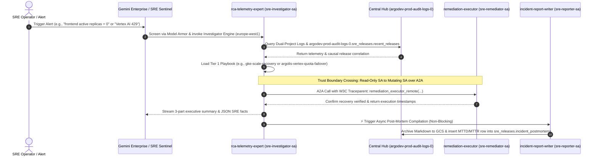
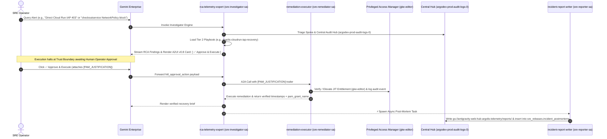

# 🏗️ NovaSRE Platform Architecture & Workflow Deep-Dive (Argolis WAF Edition)

This document details the design methodology, Hub-and-Spoke multi-project topology, per-agent least-privilege trust boundaries, universal **OneMCP** API standardizations, **Model Armor** guardrails, and request workflows of the **NovaSRE** autonomous self-healing engineering platform running in **`europe-west1`** across the `jpaquay.altostrat.com` Argolis organization.

---

## 🏛️ 1. Architectural Principles & Hub-and-Spoke Topology

To achieve enterprise-grade reliability, zero-day diagnostic depth, and rigid security compliance across live Google Cloud and Kubernetes environments, NovaSRE enforces five foundational design directives across a **Hub-and-Spoke** architecture:
- **Spoke / Runtime Host Project**: `antigravity-web-hub-argolis` (`723040006558`, Region `europe-west1`) hosts the 4 Vertex AI Reasoning Engines, the `online-boutique` GKE Autopilot cluster, Direct IAP-protected Cloud Run services, and the `gs://antigravity-web-hub-argolis-telemetry` & `gs://antigravity-web-hub-argolis-sre-playbooks` buckets.
- **Central Logging & Audit Hub (`cs-audit`)**: `argodev-prod-audit-logs-0` (`618001173803`, Region `europe-west1`) aggregates cross-project GKE, Cloud Run, Reasoning Engine, and PAM audit logs via Cloud Logging sinks (`sre-gke-pam-telemetry-sink`, `reasoning-engine-sink`, `cloud-run-adk-sink`, `audit-logs`) and hosts the `sre_releases` BigQuery dataset (`recent_releases` and `incident_postmortems` with `PHYSICAL` storage billing).

```mermaid
graph TD
    subgraph FrontDoor ["Operator Front Doors (europe-west1)"]
        GE["Gemini Enterprise Console<br/>Natural-Language Chat, Routing<br/>& A2UI v0.8 HITL Approval"]
        COPILOT["aibru26 SRE Sentinel & Copilot<br/>12-Agent A2A Arena Integration"]
    end

    subgraph RuntimeHost ["Spoke Runtime Host: antigravity-web-hub-argolis (723040006558 / europe-west1)"]
        MA["Model Armor Inline Guard<br/>Prompt Injection / SDP Screening"]
        InvAgent["Investigator Agent<br/><b>rca-telemetry-expert</b><br/>SA: sre-investigator-sa (Read-Only)"]
        RemAgent["Remediation Worker<br/><b>remediation-executor</b><br/>SA: sre-remediator-sa (A2A + PAM JIT)"]
        DocAgent["Documentation Compiler<br/><b>incident-report-writer</b><br/>SA: sre-reporter-sa (Async Writer)"]
        SimAgent["Chaos Engine<br/><b>outage-simulator</b><br/>SA: sre-simulator-sa (11 Simulations)"]
        GKE["GKE Autopilot: online-boutique<br/>europe-west1 (12 Microservices)"]
        GCS["GCS Buckets<br/>antigravity-web-hub-argolis-telemetry<br/>& antigravity-web-hub-argolis-sre-playbooks"]
    end

    subgraph SkillEcosystem ["35 Modular Skills (app/skills/ & GCS Playbook Bucket)"]
        DiagSkills["Layer 1: Diagnostics & Triage<br/>10 Specialist Skills"]
        PlaybookSkills["Layer 2: Recovery Playbooks<br/>11 SRE Remediation Playbooks"]
        SimSkills["Layer 3: Chaos Simulations<br/>11 Outage Injection Playbooks"]
        ReportSkills["Layer 4: Incident Reporting<br/>3 Post-Mortem Skills"]
    end

    subgraph OneMCPGateway ["Universal OneMCP Gateway (Dual-Project Aware)"]
        LOG_MCP["Logging OneMCP<br/>logging.googleapis.com"]
        MON_MCP["Monitoring OneMCP<br/>monitoring.googleapis.com"]
        TRACE_MCP["Trace OneMCP<br/>cloudtrace.googleapis.com"]
        ERR_MCP["Error Reporting OneMCP<br/>clouderrorreporting.googleapis.com"]
        GKE_MCP["GKE OneMCP<br/>container.googleapis.com"]
        COMPUTE_MCP["Compute & VPC OneMCP<br/>compute.googleapis.com"]
        BQ_MCP["BigQuery OneMCP<br/>bigquery.googleapis.com"]
        GCS_MCP["GCS OneMCP<br/>storage.googleapis.com"]
    end

    subgraph AuditHub ["Central Logging & Audit Hub: argodev-prod-audit-logs-0 (618001173803 / cs-audit)"]
        BQ_REL["BigQuery: sre_releases.recent_releases<br/>Clustered by service_name, namespace"]
        BQ_INC["BigQuery: sre_releases.incident_postmortems<br/>Partitioned by DATE(incident_start_time)"]
        BQ_AUDIT["BigQuery: audit_export & agent_analytics<br/>Cross-Org Audit Logs & OTel Spans"]
    end

    GE <-->|"3LO OAuth + A2UI v0.8"| MA
    COPILOT <-->|"A2A JSON-RPC / REST"| MA
    MA <--> InvAgent
    GE -->|"Agent Runtime"| SimAgent

    InvAgent -->|"A2A + W3C Traceparent + [PAM_JUSTIFICATION]"| RemAgent
    InvAgent -.->|"Async Zero-Call Post-Mortem"| DocAgent

    InvAgent --- DiagSkills
    InvAgent --- PlaybookSkills
    SimAgent --- SimSkills
    DocAgent --- ReportSkills

    InvAgent --> LOG_MCP
    InvAgent --> MON_MCP
    InvAgent --> TRACE_MCP
    InvAgent --> ERR_MCP
    InvAgent --> GKE_MCP
    InvAgent --> COMPUTE_MCP
    InvAgent --> BQ_MCP
    InvAgent --> GCS_MCP

    RemAgent --> GKE_MCP
    RemAgent --> COMPUTE_MCP
    SimAgent --> GKE_MCP
    DocAgent --> GCS_MCP
    DocAgent --> BQ_MCP

    GKE_MCP --> GKE
    COMPUTE_MCP --> GKE
    BQ_MCP --> BQ_REL
    BQ_MCP --> BQ_INC
    LOG_MCP --> BQ_AUDIT
    GCS_MCP --> GCS
```

### 1. Decomposed Per-Agent Trust Boundaries & PAM JIT Elevation
A critical pattern in enterprise AI Ops is ensuring that diagnostic agents cannot mutate production state, while remediation execution workers operate only upon explicit, verified diagnostic or human authorization:
* **Read-Only Investigation Boundary (`rca-telemetry-expert` / `sre-investigator-sa`)**: Equipped exclusively with read-only permissions on `antigravity-web-hub-argolis` (`logging.viewer`, `monitoring.viewer`, `cloudtrace.viewer`, `errorreporting.viewer`, `container.viewer`, `compute.viewer`, `storage.objectViewer`) and cross-project read-only access to `argodev-prod-audit-logs-0` (`logging.viewer`, `bigquery.dataViewer`, `bigquery.jobUser`). Zero mutating GKE or Compute permissions.
* **Mutating Remediation Boundary (`remediation-executor` / `sre-remediator-sa`)**: An isolated worker identity endowed with `container.developer` and `compute.networkAdmin` on `antigravity-web-hub-argolis` and registered as an `eligibleUser` on the `gke-editor` **Privileged Access Manager (PAM)** entitlement. Executes Tier 1 auto-remediation or Tier 2 HITL-approved maneuvers with mandatory `[PAM_JUSTIFICATION]:` audit trails logged to `argodev-prod-audit-logs-0`.
* **Scoped Post-Mortem Reporting Boundary (`incident-report-writer` / `sre-reporter-sa`)**: Granted `storage.objectAdmin` on `gs://antigravity-web-hub-argolis-telemetry` and cross-project `roles/bigquery.dataEditor` + `roles/bigquery.jobUser` on `argodev-prod-audit-logs-0:sre_releases` to persist Markdown post-mortems and structured MTTD/MTTR rows in `incident_postmortems`.
* **Scoped Chaos Simulation Boundary (`outage-simulator` / `sre-simulator-sa`)**: Restricted to controlled synthetic fault injection across the 11 simulation scenarios.

### 2. Model Armor Inline Screening & Zero Org-Policy Override
* **Model Armor Guard (`screen_prompt_with_model_armor`)**: Every inbound prompt and HITL payload is screened before tool execution or A2A delegation to block prompt injection (`<ce_input>` tag overrides), jailbreak attempts, and sensitive credential exfiltration.
* **Strict Argolis Compliance (`go/argolis-iam-rules`)**: Never overrides `constraints/iam.allowedPolicyMemberDomains` and enforces zero `allUsers`, zero `allAuthenticatedUsers`, and zero `@google.com` bindings.

### 3. Standardized Dual-Project Integration via Universal OneMCP Gateways
All agents communicate with cloud infrastructure through universal **Google Cloud OneMCP** servers over streamable HTTP+SSE connections, passing `x-goog-user-project` headers to seamlessly query both `antigravity-web-hub-argolis` and `argodev-prod-audit-logs-0`:
* `logging.googleapis.com/mcp` & `monitoring.googleapis.com/mcp`: Dual-project log event extraction and PromQL/time-series queries.
* `cloudtrace.googleapis.com/mcp` & `clouderrorreporting.googleapis.com/mcp`: Distributed trace decomposition and exception group analysis.
* `container.googleapis.com/mcp` & `compute.googleapis.com/mcp`: Kubernetes workload, Service, NetworkPolicy, Cloud NAT, and Shared VPC inspection/mutation.
* `bigquery.googleapis.com/mcp` & `storage.googleapis.com/mcp`: Cross-project release correlation (`argodev-prod-audit-logs-0.sre_releases.recent_releases`), post-mortem ledger insertion (`incident_postmortems`), and GCS playbook/report archival.

### 4. Verified Model Tiering (`gemini-2.5-flash` & `gemini-3.1-pro-preview`)
* **Baseline High-Speed Triage**: Defaults to `GEMINI_MODEL="gemini-2.5-flash"` in `europe-west1` with automatic `global` $\leftrightarrow$ `europe-west1` failover via `GlobalGemini`.
* **Tier 3 Deep Reasoning Escalation**: Supports `GEMINI_PRO_MODEL="gemini-3.1-pro-preview"` for complex, unscripted zero-day root-cause synthesis.

---

## 🛡️ 2. Core Agent Matrix & Per-Agent Service Account Topology

| Pillar | Agent Name | Dedicated Service Account (`antigravity-web-hub-argolis`) | IAM & Cross-Project Scope | Core Embedded Skills & Capabilities |
| :--- | :--- | :--- | :--- | :--- |
| **Investigation** | `rca-telemetry-expert` | `sre-investigator-sa@...` | **Read-Only Spoke + Hub** Spoke: `logging.viewer`, `monitoring.viewer`, `cloudtrace.viewer`, `errorreporting.viewer`, `container.viewer`, `compute.viewer`, `storage.objectViewer` Hub (`argodev-prod-audit-logs-0`): `logging.viewer`, `bigquery.dataViewer`, `bigquery.jobUser` | 10 Diagnostic Skills (`investigation-entrypoint`, `sre-correlation`, `gcp-logging`, `gcp-monitoring`, `gke-workloads`, `gke-networking`, `google-cloud-networking-observability`, `google-cloud-global-frontend-configuration`, `gcp-trace`, `gcp-error-reporting`) + all 11 Recovery Playbooks. |
| **Remediation** | `remediation-executor` | `sre-remediator-sa@...` | **Mutating Worker + PAM JIT** Spoke: `container.developer`, `compute.networkAdmin`, `mcp.toolUser`, `aiplatform.user` PAM Entitlement: `gke-editor` | Executes declarative GKE & GCP healing actions over A2A, requests/logs PAM JIT elevation for Tier 2 HITL actions, and verifies post-action readiness. |
| **Documentation** | `incident-report-writer` | `sre-reporter-sa@...` | **Post-Mortem Archival Boundary** Spoke: `storage.objectAdmin` on telemetry bucket Hub (`argodev-prod-audit-logs-0`): `bigquery.dataEditor`, `bigquery.jobUser` on `sre_releases` | 3 Reporting Skills (`postmortem-generator`, `postmortem-documentation`, `postmortem-aggregator`). Zero-call timeline compilation, GCS Markdown archival, and BigQuery `incident_postmortems` insertion. |
| **Chaos Engine** | `outage-simulator` | `sre-simulator-sa@...` | **Simulation Sandbox Boundary** Spoke: `container.developer`, `mcp.toolUser`, `aiplatform.user`, `logging.logWriter` | 11 Chaos Simulation Skills (`app/skills/simulations/*`) covering 8 GKE `online-boutique` faults and 3 Argolis fleet drift scenarios. |

---

## 🔄 3. Request Workflow & Execution Sequences

### Sequence 1: Autonomous Auto-Remediation (Tier 1 Fast-Path — Playbooks 1, 2, 6, 10)
When an anomaly matches a pre-approved Tier 1 playbook (such as `gke-scale-recovery`, `gke-crashloop-rollback`, `gke-dns-recovery`, or `argolis-vertex-quota-failover`), detection-to-recovery executes autonomously:

---

### Sequence 2: Gated Human-in-the-Loop + PAM JIT Remediation (Tier 2 — Playbooks 3, 4, 5, 7, 8, 9, 11)
When an anomaly requires stateful disruption, capacity scaling, network policy deletion, Direct Cloud Run IAP IAM binding, or Shared VPC / Log Router sink restoration, `rca-telemetry-expert` halts at the trust boundary and renders an interactive **A2UI v0.8 approval card**:

---

## 📑 4. Telemetry Timeline Integrity & Dual GCS + BigQuery Archival

To eliminate arbitrary UI click timestamps and avoid redundant secondary telemetry API calls during post-mortem generation:
1. **`incident_start_time`**: Extracted directly from the earliest matching error log event or metric anomaly timestamp during triage.
2. **`detection_time`**: Recorded when `rca-telemetry-expert` initiates triage.
3. **`mitigation_executed_time` & `recovery_verified_time`**: Recorded by `remediation-executor` upon verifying healthy post-remediation state.
4. **Dual Persistence (`archive_postmortem_report`)**:
   - Writes the formatted GitHub Flavored Markdown report to **`gs://antigravity-web-hub-argolis-telemetry/reports/post_mortem_<INCIDENT_ID>.md`**.
   - Inserts a structured row containing `mttd_seconds`, `mttr_seconds`, `pam_grant_name`, and `report_gcs_uri` into **`argodev-prod-audit-logs-0.sre_releases.incident_postmortems`** (`europe-west1`).
